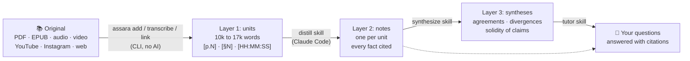

<div align="center">


# Assara

**Press your books, courses, videos and web pages into short, citable notes,<br>then cross them into syntheses you can trust.**

[](https://github.com/mmca950/assara/actions/workflows/ci.yml)
[](LICENSE)

[](https://docs.claude.com/en/docs/claude-code)


[Quick start](#quick-start) ·
[See it](#what-you-get) ·
[How it works](#how-it-works) ·
[Docs](#documentation) ·
[Contributing](CONTRIBUTING.md)

</div>

---

You read a 300-page book, follow a 20-hour course, watch a dozen talks. Three months later you remember
a few ideas, not where they came from, and not which author disagreed. Asking a chatbot "what does this
PDF say" gives you a fluent answer you cannot check.

**Assara** turns each source into a **note you can verify** (every fact points to a page, a paragraph or a
timestamp) and then **crosses the notes** of several sources into synthesis sheets that show where they
agree, where they diverge, and how solid each claim is.

- 🫒 **A Python CLI** does the mechanical part: extracts PDF and EPUB, transcribes audio and video, fetches
  YouTube, Instagram and web pages, and cuts everything into units with stable markers. No AI involved.
- ✍️ **Four Claude Code skills** do the reading: they distill each unit into a structured note, merge notes
  into syntheses, and answer your questions with citations.

> *The name:* in Moroccan Arabic the olive press is *lmaâsra*, and *assara* (عصّارة) is the one that presses.
> Assara presses your sources until only what is worth keeping is left.

## What you get

The repository ships a complete example library built from a public-domain text,
[*The Art of War*](examples/art-of-war/) (Sun Tzu, Giles translation, 1910). One unit of about 11,000 words
became [a note of about 2,400 words](examples/art-of-war/sources/AOW/notes/u03.md). Every figure is kept, and
every line is cited:

| Item | Value | Source |
|---|---|---|
| Forced march of 100 li, double distance, day and night | leaders of all 3 divisions captured; one-tenth of the army arrives | AOW u03 §134, §136, §137 |
| March of 50 li to outmanoeuvre | leader of the first division lost; half the force arrives | AOW u03 §139 |
| Soldier's spirit over the day | keenest in the morning, flags by noon, wants camp in the evening | AOW u03 §189, §191 |

The note also keeps track of **who says what**: Sun Tzu's verses, the classical commentators and the
translator's own remarks are never blended into one voice. A
[synthesis sheet](examples/art-of-war/synthesis/strategy-course/deception-and-surprise.md) then turns the
note into arguments, ranked by importance, with doubts flagged:

> **Surprise is defined by what the enemy expects (importance 5/5)**
> - According to AOW u03 §8 (Sun Tzu), the direct method engages and the indirect method wins.
> - According to AOW u03 §6 (Giles), cheng is any move the enemy is watching, ch'i the one that surprises him;
>   a surprise that is spotted becomes cheng.
> - According to AOW u03 §6 (Ho Shih, Han Hsin at Lin-chin), the open march was cheng and the river crossing
>   in wooden tubs was ch'i. Anecdote, **to verify**.

## How it works



| Layer | What | Who reads it |
|---|---|---|
| **1. Units** | raw text or transcript, cut into units that fit a context window, with page, paragraph or time markers | nobody in full: lookup and quotes only |
| **2. Notes** | one note per unit (1,200 to 2,000 words): concepts, every figure, processes, studies and cases, doubts | you and Claude: the working layer |
| **3. Syntheses** | one sheet per topic, crossing sources: agreements, divergences side by side, solidity, what is missing | your projects |

Answers come from notes, not from raw text, so they are **fast, cheap and traceable**. The raw text is
reopened only to check a quote. Details: [docs/architecture.md](docs/architecture.md).

## Features

| | |
|---|---|
| 🔎 **Citations everywhere** | every fact carries its source in full form, one format per source type (below) |
| 🧭 **Never invents** | claims without evidence are marked *to verify*, whoever makes them; garbled passages are flagged, never guessed; an inaccessible page is recorded, never imagined |
| 🗣️ **Voices kept apart** | author, translator, commentator, interviewee: the note always says who claims what |
| ⚖️ **Divergences side by side** | syntheses show where sources disagree instead of averaging them away |
| 🛡️ **Stable citations** | rebuilding units refuses to move text that a note already cites; `init` never overwrites your files |
| 🎙️ **Local transcription** | faster-whisper on CPU or GPU, existing subtitles reused first, resumable passes |
| 🌐 **Links** | single YouTube videos (subtitles first, Whisper as fallback), public Instagram posts and carousels (with OCR), web pages, or a whole file of links |
| 🔒 **Hostile text is data** | text from sources is never followed as instructions; links to private network addresses are refused; control characters cannot drive your terminal |

### Citation formats

| Source | Format | Example |
|---|---|---|
| PDF | `CODE uNN [p.N]` | `BOOK1 u03 [p.88]` |
| EPUB | `CODE uNN §N` | `AOW u03 §12` |
| Audio, video | `CODE chNN [HH:MM:SS]` | `TALK1 ch01 [00:14:05]` |
| Instagram | `CODE pNN s.N` or `CODE pNN caption` | `IG1 p04 s.2` |
| Web page | `CODE wNN` | `WEB1 w01` |

## Quick start

**Requirements:** Python 3.10 or later, and [Claude Code](https://docs.claude.com/en/docs/claude-code) for
the notes and syntheses. The CLI alone runs without it.

```bash
# 1. Install (PyPI release to come; uv recommended)
uv tool install "assara[pdf,epub] @ git+https://github.com/mmca950/assara"

# 2. Create a library
assara init ~/library && cd ~/library

# 3. Add a source
cp ~/Downloads/book.pdf inbox/
assara add BOOK1 inbox/book.pdf --title "The Title, A. Author, 1998"
assara status

# 4. Distill it with Claude Code
claude
```

Then, in Claude Code, ask in plain words:

```text
> distill u01 of BOOK1                                  # read the note, ask for adjustments
> distill all of BOOK1
> synthesize the notes tagged [MyProject-Topic]
> what do my sources say about spaced repetition?
```

Before your first note, fill the library's `CLAUDE.md` (every item marked `FILL:`): who the library is
for, your projects, your scope rules.

<details>
<summary><b>Other ways to install</b> (pip, extras, Docker)</summary>

<br>

| Extra | Adds |
|---|---|
| (none) | core only: `init`, `status`, `regroup` |
| `pdf` | PDF (PyMuPDF) |
| `epub` | EPUB (ebooklib, BeautifulSoup) |
| `audio` | audio and video transcription (faster-whisper) |
| `links` | YouTube, Instagram, web pages (yt-dlp, instaloader, requests) |
| `all` | everything |

```bash
pip install "assara[all] @ git+https://github.com/mmca950/assara"

# Docker: every extra and every system tool included
docker build -t assara .
docker run --rm -v ~/library:/library assara init /library
docker run --rm -v ~/library:/library -v ~/books:/in:ro assara add BOOK1 /in/book.pdf --title "Title, Author, Year"
```

A command that needs a missing extra stops and prints the exact install line. System tools (`pdftotext`,
`ffmpeg`, `tesseract`, `ocrmypdf`) and Whisper on GPU: [docs/installation.md](docs/installation.md).

</details>

## Commands

| Command | Does |
|---|---|
| `assara init FOLDER` | create a library: config, folders, `CLAUDE.md`, templates, skills |
| `assara add CODE FILE --title "..."` | PDF or EPUB to units and INDEX |
| `assara transcribe CODE FILE_OR_FOLDER --title "..." --language en` | audio or video to units (reuses `.srt`, else faster-whisper) |
| `assara link URL --code CODE` | YouTube video, Instagram post or web page to units (`--file LIST.txt` for a file of links) |
| `assara regroup CODE` | group many short lessons into modules |
| `assara rebuild-pdftotext CODE FILE.pdf` | rebuild units with `pdftotext` when the PDF text comes out garbled |
| `assara status [CODE...]` | notes done and pending per source (`--sync` writes (done) in the INDEX) |

`assara <command> -h` lists every option.

## Skills

`assara init` installs four skills in `<library>/.claude/skills/`. Claude Code picks them up when you start
it in the library folder.

| Skill | Triggered by | Writes |
|---|---|---|
| `add-source` | "add this book", "transcribe this course", "add this link" | `sources/<CODE>/` via the CLI, catalog, queue, journal |
| `distill` | "distill u03 of BOOK1", "distill all of BOOK1" | one note per unit |
| `synthesize` | "update the synthesis", "what do the sources say about X" | `synthesis/<project>/` |
| `tutor` | "explain X", "which source talks about Y" | nothing: answers from syntheses and notes |

Permissions, sub-agents and cost: [docs/claude-code.md](docs/claude-code.md).

## FAQ

<details>
<summary><b>Why not just chat with my PDFs (RAG)?</b></summary>

<br>

Retrieval gives a model a few chunks at question time and lets it write a fluent answer. Assara does the
reading once, up front, and keeps the result: a note per unit that you can read, correct and cite. Answers
then come from notes you have already checked, with a page or a timestamp behind every fact. And when two
sources disagree, the synthesis shows both positions instead of blending them.

</details>

<details>
<summary><b>Does it need Claude Code? Does my text leave my machine?</b></summary>

<br>

The CLI (extraction, transcription, links) runs on your machine and calls no AI service; Whisper runs
locally too.
Notes and syntheses are written by Claude Code, so the units you ask it to distill are sent to Claude as
any Claude Code session would send them.

</details>

<details>
<summary><b>What does it cost?</b></summary>

<br>

The CLI is free. Distilling costs Claude usage: roughly one unit of 10,000 to 17,000 words read per note.
After that, questions are answered from notes and syntheses, which are about ten times shorter than the
raw text. Tips in [docs/claude-code.md](docs/claude-code.md).

</details>

<details>
<summary><b>Which languages?</b></summary>

<br>

Any language your sources and Claude handle. Extraction keeps right-to-left scripts (with a `pdftotext`
rebuild when PyMuPDF garbles them), Whisper transcribes most spoken languages, and the language of notes is
a setting of your library.

</details>

<details>
<summary><b>Can I use it on copyrighted books and courses?</b></summary>

<br>

Only on sources you are allowed to read. Originals, raw text and units stay private; anything you publish
is rewritten in your own words. Assara never circumvents DRM and has no downloader that needs a logged-in
session. Read [docs/legal.md](docs/legal.md).

</details>

## Documentation

| | |
|---|---|
| [Installation](docs/installation.md) | extras, system tools, Whisper on CPU or GPU, Docker |
| [Usage](docs/usage.md) | a full walk-through, from a PDF to a synthesis |
| [Architecture](docs/architecture.md) | the three layers, citations, folder layout |
| [Configuration](docs/configuration.md) | every key of `assara.toml` |
| [Claude Code](docs/claude-code.md) | skills, permissions, sub-agents, cost |
| [Legal](docs/legal.md) | copyright, platform terms, no DRM circumvention |

## Contributing

Ideas and bug reports are welcome in the [issues](https://github.com/mmca950/assara/issues).
Contributions are welcome, to the code **and to the method**: a change to a skill or a template matters
as much as a change to the code. Start with [CONTRIBUTING.md](CONTRIBUTING.md); please follow the
[Code of Conduct](CODE_OF_CONDUCT.md). Report security problems privately: see [SECURITY.md](SECURITY.md).

```bash
uv venv .venv && uv pip install -p .venv/bin/python -e ".[dev]"
.venv/bin/pytest -q
.venv/bin/ruff check . && .venv/bin/ruff format --check src tests
```

## Licence and citation

[MIT](LICENSE). If Assara helps your research, cite it with [CITATION.cff](CITATION.cff) (GitHub shows a
"Cite this repository" button). Changes are listed in [CHANGELOG.md](CHANGELOG.md).

<div align="center">
<br>
<sub>Made with 🫒 and a lot of footnotes.</sub>
</div>
